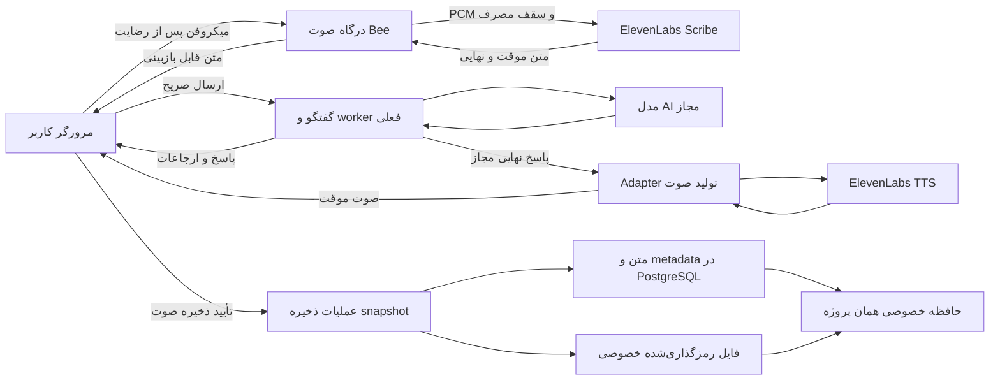

# طرح فنی ElevenLabs و حافظه صوتی Bee Researcher

تاریخ: ۱۱ اکتبر ۲۰۲۶. مبنای طراحی: نسخه 3.44.0، schema `0048_reader_research`. **پیاده‌سازی دامنه اصلی: نسخه 3.45.0 با migration افزایشی `0049_reader_voice`.** بخش‌های این سند تصمیم‌های طراحی را ثبت می‌کنند؛ قرارداد اجرایی دقیق routeها و payloadها در `app/news_voice/api.py` و `schemas.py` و روش فعال‌سازی در [راهنمای عملیات](ELEVENLABS-VOICE-OPERATIONS-fa.md) است. آزمون حساب واقعی و مرورگر/دستگاه واقعی مرحله صفر هنوز لازم است؛ Agents مرحله سوم اختیاری پیاده‌سازی نشده است.

دامنه محصول و متن رابط: [طرح محصول](ELEVENLABS-VOICE-PROPOSAL-fa.md). وظایف و پذیرش: [backlog](ELEVENLABS-VOICE-BACKLOG-fa.md).

## ۱. معماری پیشنهادی

ElevenLabs لایه صوت باشد؛ ساخت پاسخ از `news_chat.service` و worker فعلی عبور کند. منبع AI فقط خبر منتشرشده مجاز و حافظه/زمینه‌ای باشد که کاربر صریحاً انتخاب کرده است. کلید ElevenLabs، متن زمینه و اختیار انتخاب principal از مرورگر پذیرفته نشوند.

نسخه اول نوبتی است: بازبینی گفتار ← Send ← پاسخ نهایی ← صوت. نسخه بعد، streaming متن به صوت و interruption را اضافه کند. شروع صوت روی پیش‌نویس پاسخِ هنوز تأییدنشده، پیش از حل مسئله ارجاعات و شکست تولید، فعال نشود.

## ۲. قرارداد ElevenLabs و انتخاب مدل

| نیاز | قرارداد رسمی | تصمیم طراحی |
|---|---|---|
| STT زنده | `wss://api.elevenlabs.io/v1/speech-to-text/realtime`؛ `scribe_v2_realtime`؛ رویدادهای `partial_transcript` و `committed_transcript` | اتصال از سرور؛ `pcm_16000`، mono، 16-bit little-endian به‌عنوان فرمت آغازین؛ تبدیل نرخ نمونه واقعی مرورگر لازم است |
| TTS پاسخ نهایی | `POST /v1/text-to-speech/{voice_id}/stream` | کاندید آغازین فارسی `eleven_v3`؛ تست واقعی API و صدا شرط فعال‌سازی است |
| هم‌زمان‌سازی متن | `POST /v1/text-to-speech/{voice_id}/stream/with-timestamps` | فقط اگر مدل انتخابی این endpoint را واقعاً پشتیبانی کند؛ parser JSON streaming، نه فرض MP3 خام |
| صوت کم‌تأخیر مرحله دوم | `wss://api.elevenlabs.io/v1/text-to-dialogue/stream-input` | `eleven_v3_conversational` کاندید مطابق مرجع؛ v4 Turbo پس از آزمون سازگاری حساب بررسی شود |

منابع قرارداد: [STT Realtime](https://elevenlabs.io/docs/api-reference/speech-to-text/v-1-speech-to-text-realtime)، [HTTP speech streaming](https://elevenlabs.io/docs/api-reference/text-to-speech/stream)، [timing](https://elevenlabs.io/docs/api-reference/text-to-speech/stream-with-timestamps)، [TTD WebSocket](https://elevenlabs.io/docs/api-reference/text-to-dialogue/ttd-websocket).

مدل/voice/زبان/output format باید یک ماتریس قابلیت نسخه‌دار داشته باشند. `GET /v1/models` و آزمایش همان endpoint مکمل فهرست مستندات‌اند؛ نبود خطای handshake کافی نیست، باید صوت صحیح دریافت شود. نام فارسی در STT با `fa` یا `fas` طبق قرارداد endpoint و در TTS با کد پشتیبانی‌شده تنظیم شود. [کد زبان STT](https://elevenlabs.io/docs/api-reference/speech-to-text/v-1-speech-to-text-realtime)

**اختلاف مستندات ثبت‌شده:** راهنمای [TTD و مقایسه WebSocketها](https://elevenlabs.io/docs/eleven-api/guides/how-to/websockets/tts-vs-ttd-websockets) خانواده v4 را نام می‌برد، اما [مرجع API TTD](https://elevenlabs.io/docs/api-reference/text-to-dialogue/ttd-websocket) هنوز v3-only است. انتخاب v4 تا تأیید account/endpoint یک آزمایش است. مدل v3/v4 را نباید بی‌بررسی به TTS `stream-input` قدیمی فرستاد. این تفاوت بر انتخاب adapter اثر دارد، نه بر قرارداد داخلی حافظه.

برای TTD، adapter باید آغاز نشست/ثبت voices، `inputs`، `new_turn`، `flush`، پایان نوبت و پایان اتصال را جدا پردازش کند. بایت‌های MP3 ممکن است نزدیک مرز نوبت با encoder buffer جابه‌جا شوند؛ برای جداسازی دقیق نوبت، PCM یا اتصال مستقل برای هر نوبت بررسی شود. [مرجع TTD و مرز صوت](https://elevenlabs.io/docs/api-reference/text-to-dialogue/ttd-websocket)

audio alignment یک داده اختیاری است. زمان‌های محلی chunk به زمان کلی نوبت تبدیل شوند؛ نرمال‌سازی فارسی، Unicode و اختلاف `spoken_text` با متن نمایشی باید mapping مشخص داشته باشد. timing نامعتبر حذف شود؛ متن و پخش بدون highlight همچنان کار کنند. [timing رسمی](https://elevenlabs.io/docs/api-reference/text-to-speech/stream-with-timestamps)

## ۳. جریان ورودی و محافظت نشست

`POST voice-sessions` ابتدا current_reader، عضویت پروژه، دسترسی به همه خبرهای context، grant گفتگو، سیاست صوت، وضعیت deployment drain و رزرو سهمیه را بررسی کند. پاسخ شامل شناسه داخلی، deadline و ticket یک‌بارمصرفِ Bee است؛ کلید یا token ElevenLabs برنگردد.

WebSocket هم‌مبدأ با cookie معتبر و Origin دقیق پذیرفته شود. ticket Bee در نخستین پیام ارسال، به user/project/session/connection وصل و یک بار مصرف شود؛ timeout پیشنهادی handshake پنج ثانیه و TTL ticket سی ثانیه است. این اعداد سیاست پیشنهادی Bee هستند، نه محدودیت ElevenLabs. tokenها در query، لاگ و localStorage نوشته نشوند.

مرورگر AudioWorklet نرخ نمونه واقعی را به قرارداد PCM تبدیل کند. قاب‌ها شماره ترتیبی، سقف اندازه و سقف نرخ داشته باشند؛ مدت از بایت‌ها/فرمت معتبر روی سرور محاسبه شود، نه از مقدار ادعایی client. backpressure و قطع ارسال در توقف لازم‌اند. partial transcript قابل جایگزینی است؛ committed segment با شناسه داخلی deduplicate و به پیش‌نویس اضافه شود. partial/edited/provider events نباید مستقیماً به worker فرستاده شوند.

نسخه اول از commit دستی یا VAD فقط برای مرزبندی گفتار استفاده کند؛ اقدام Send همچنان صریح است. echo cancellation و noise suppression درخواست شوند، ولی کیفیت واقعی دستگاه و صدای بلندگو در PoC سنجیده شود. [commit و فرمت صوت](https://elevenlabs.io/docs/eleven-api/guides/how-to/speech-to-text/realtime/transcripts-and-commit-strategies)

درگاه با سقف مدت، نبود داده کاربر، اتمام بودجه، لغو عضویت/انتشار، خروج، تعویض پروژه یا رسیدن deadline ارتباط upstream و میکروفن را قطع کند. heartbeat داخلی هزینه، نشست بیکار کاربر را تمدید نکند؛ هر تمدید از فعالیت واقعی و سیاست فعلی نشست عبور کند. محدودیت خروج شبانه و سقف مطلق نشست حفظ شوند. بستن سوکت مرورگر به‌تنهایی اثبات بسته‌شدن اتصال ElevenLabs نیست؛ cleanup مستقل و watchdog لازم است.

اتصال مستقیم STT با single-use token در مستندات وجود دارد و token موقت پانزده دقیقه‌ای است؛ **برای کنترل هزینه سخت Bee مسیر اصلی نیست**، چون timer رابط یا انقضای bootstrap تضمین پایان مصرف یک اتصال باز نیست. [client-side STT](https://elevenlabs.io/docs/eleven-api/guides/how-to/speech-to-text/realtime/client-side-streaming)

## ۴. تولید، پخش و ضبط صوت

- TTS فقط `generation_id` مجاز دریافت کند. متن ارسالی از پاسخ همان generation روی سرور استخراج شود؛ POST با متن دلخواه نباید API تبدیل متن عمومی و نامحدود بسازد.
- کلید تولید از generation، hash متن قابل گفتن، provider/model/voice، زبان، تنظیمات و نسخه preprocessing ساخته شود. deduplication فقط در همان مالک و پروژه باشد؛ صدای خصوصی دو کاربر cache مشترک ندارد.
- markdown، URL و citation ID خام از متن گفتاری پاک/تبدیل شوند؛ معنی پاسخ و ارجاعات متن اصلی تغییر نکند. audio tagهای ورودیِ غیرقابل اعتماد مجاز نباشند. پاسخ قدیمی بعد از تغییر متن با صوت قبلی اشتباه جفت نشود.
- زبان TTS با زبان همان generation سازگار باشد؛ تغییر زبان رابط یا انتخاب voice متن را ترجمه نکند. محدودیت اندازه متن از ماتریس مدل روی سرور بررسی شود؛ متن بلند فقط با قطعه‌بندی پایدار، رزرو هزینه همه قطعات و manifest کامل تولید شود، یا خطای روشن بگیرد. قطع خاموش انتهای پاسخ مجاز نیست.
- صوت دریافت‌شده در staging رمزگذاری‌شده کوتاه‌عمر نگهداری شود؛ این با «حافظه دائمی» فرق دارد و وضعیتش باید در اطلاع‌رسانی محصول ذکر شود. پیشنهاد TTL: پانزده دقیقه پس از پایان کار، به‌علاوه cleanup فوری پس از close/expiry برای ذخیره‌نشده‌ها.
- پخش از همان بایت‌ها انجام شود؛ replay/دانلود/save فایل موجود، درخواست تازه ElevenLabs ایجاد نکند. تغییر voice یا تولید صوت متن قدیمی، عملیات پولی تازه با تأیید است.
- برای ضبط کاربر، انتخاب `retain_user_audio_for_save` قبل از دریافت اولین frame ثبت شود. نسخه اول همین PCM مجازِ ارسالی به STT را با زمان‌بندی ذخیره کند؛ MediaRecorder یا getDisplayMedia برای ضبط بلندگوی سیستم لازم نباشد.
- برای گفتگوی کامل، trackهای کاربر/AI و manifest ترتیب نوبت‌ها نگهداری شوند. نسخه اول export مرتب نوبت‌ها کافی است و باید همین نام را نمایش دهد. در interruption، «آنچه شنیده شد» با صوت تولیدشده یکسان نیست؛ playback acknowledgement و بازه‌های قطع‌شده برای خروجی واقعی لازم‌اند. صدای گمشده ساخته یا از زبان دیگر جایگزین نشود.
- manifest نسخه‌دار باید شناسه نوبت/generation، hash متن اصلی و متن گفتاری، متن تشخیص‌داده‌شده و سؤال واقعاً ارسال‌شده، نسخه preprocessing و بازه فایل را به هم وصل کند. ویرایش transcript نباید به‌عنوان تغییر صدای خام معرفی شود؛ این داده‌ها فقط همراه همان دارایی خصوصی حفظ شوند.

## ۵. مدل داده پیشنهادی

| جدول/موجودیت | داده اصلی و قید |
|---|---|
| `reader_voice_sessions` | user/project/conversation، deadline و lease، وضعیت، زبان/فرمت، رضایت انتقال و ضبط، meter مدت؛ FKها برای حذف مالک/پروژه/گفتگو CASCADE |
| `reader_voice_audio` | asset UUID، مالک/پروژه/گفتگو، generation/نوبت‌های منتخب، دامنه `ai` یا `dialogue`، وضعیت preparing/ready/failed/deleting، saved_at، completeness، نسخه snapshot، provider/model/voice، object key، hash و اندازه/مدت/codec |
| `reader_voice_segments` | asset/turn، speaker، ترتیب، بازه فایل/زمان، اتصال به transcript و generation، بازه پخش‌شده/قطع‌شده؛ manifest محتوایی خصوصی |
| `reader_voice_save_jobs` | job UUID، مالک/پروژه/گفتگو، کلید idempotency یکتا برای مالک، hash payload/snapshot، رضایت حفظ متن، وضعیت و deadline/lease محدود، asset نتیجه؛ مرجع recovery و جلوگیری از رقابت close/save |
| `reader_voice_usage` | عملیات STT/TTS، idempotency، status، رزرو/هزینه/واحدهای اندازه‌گیری، price snapshot، estimated/settled/unknown، deadline؛ مستقل از فایل و متن |
| `reader_voice_deletion_outbox` | object identifier و کار حذف محلی/remote، وضعیت/تلاش بعدی؛ حذف parent نباید کار پاکسازی را CASCADE و ناپدید کند |

metadata مالی پس از حذف فایل/گفتگو حفظ شود؛ FKهای مربوط به داده حذف‌شدنی در دفتر هزینه SET NULL و متن/صوت در آن ذخیره نشوند. audio به گفتگوی ذخیره‌شده وابسته باشد و فقط همان مالک بتواند ببیند؛ عضویت پروژه، وضعیت انتشار همه منابع منتخب و deleted_at دوباره بررسی شوند. مالک بودن حساب Owner مجوز خواندن صوت کاربران دیگر نیست.

byteها داخل JSONB، جدول generation، لاگ، localStorage یا مسیر public قرار نگیرند. encryption key و مسیر storage برای صوت مستقل از Report باشند؛ `report_portal.crypto` الگوی جداسازی purpose را نشان می‌دهد، اما استفاده از کلید، mount یا business_id گزارش برای صوت ممنوع است.

## ۶. ذخیره اتمی، حذف و بازیابی

عملیات save یک job idempotent با مالک/پروژه/کلید و hash snapshot رزرو کند؛ تعویض payload با همان کلید 409 باشد. staging کامل با manifest و checksum احراز شود. حفظ گفتگو و انتقال asset به وضعیت ready در تراکنش metadata هماهنگ شوند؛ object storage تراکنش SQL ندارد، پس finalization و جبران شکست باید صریح باشند. job تا finalization یک lease محدود برای جلوگیری از پاک‌شدن گفتگو داشته باشد؛ lease نباید TTL بی‌نهایت بسازد.

یک قید یکتا روی هویت snapshot شامل مالک/پروژه، نوبت‌ها، hash فایل‌های منبع، دامنه و فرمت نهایی از دو ذخیره هم‌زمان با کلیدهای متفاوت جلوگیری کند. عنوان قابل ویرایش جزو هویت بایت‌ها نباشد. حفظ متن، کل رشته موجود را مطابق `PUT .../memory` نگه دارد؛ manifest صوت فقط محدوده انتخاب‌شده را نشان دهد. سقف‌ها و شرط داشتن پاسخ کامل در حافظه فعلی حفظ شوند.

حذفِ هم‌زمان بر ذخیره اولویت دارد: tombstone/deletion generation قبل از دسترسی تازه چک شود؛ callback دیررس نتواند داده را دوباره منتشر کند. orphan sweeper تنها فایل‌هایی را حذف کند که job فعال، asset ready یا lease معتبر ندارند. close قبل از رسیدن acknowledgement ذخیره با کلید درخواست تعیین تکلیف شود؛ پاک‌کردن کور staging ممنوع است.

`close_window` و retention فعلی باید job پذیرفته‌شده را زیر همان قفل admission بررسی کنند: close عادی تا پایان lease محدود save، parent را حذف نکند؛ حذف صریح job را لغو و cleanup را enqueue کند. شکست یا پایان lease، نگهداری متن ذخیره‌نشده را به سیاست فعلی برگرداند. این استثنا فقط برای درخواست ذخیره واقعاً پذیرفته‌شده است، نه صرف بازبودن پنجره.

حذف صوت فوراً دسترسی را قطع و outbox را ثبت کند؛ پاکسازی فایل، trackها، cache و نسخه‌های object storage بعداً تأیید شود. حذف گفتگو/کاربر/پروژه نیز قبل از cascade، پاکسازی را در همان تراکنش enqueue کند. حذف یا withdrawal خبر دسترسی را فوراً ببندد؛ فایل وابسته طبق سیاست حذف پاک شود. نسخه‌های backup چرخه عمر جدا دارند؛ UI نباید حذف آنی تمام backupها را ادعا کند.

مسیر فعلی `DELETE /user/api/conversations/{cid}/memory` با صوت مرتبط باید بدون رضایت حذف، `409 audio_removal_confirmation_required` بدهد. درخواست مجدد با انتخاب صریح حذف صوت، tombstone و outbox همه صوت‌ها/کارهای فعال را در همان تراکنش ثبت و سپس `saved_at` را پاک کند. کلاینت قدیمی نیز نباید بتواند فایل دائمیِ بیرون از حافظه بسازد؛ وجود asset ذخیره‌شده با parent ذخیره‌نشده یک وضعیت نامعتبر است.

پخش/دانلود هر بار auth و ACL را بررسی کند؛ حدس UUID یا URL provider مجوز نیست. برای فایل کوچک decryption کامل و سپس Range، و برای فایل بزرگ chunkهای AEAD احرازشده با index معتبر طراحی شود. Content-Type از محتوای احرازشده باشد، نام دانلود پاکسازی شود، پاسخ private/no-store و بدون URL عمومی باشد.

## ۷. API داخلی پیشنهادی

این مسیرها قرارداد پیشنهادی Bee هستند و با endpoint ElevenLabs اشتباه نشوند. تمام mutationهای HTTP به CSRF فعلی وابسته‌اند؛ کنترل WebSocket مطابق بخش ۳ است.

| روش و مسیر | قرارداد خلاصه |
|---|---|
| `GET /user/api/voice/capabilities?assistant_id={aid}` | مدل/صدای مجاز و آزموده‌شده، زبان، ظرفیت، محدودیت و امکان ضبط؛ بدون key و اطلاعات کاربران دیگر |
| `POST /user/api/conversations/{cid}/voice-sessions` | زبان، رضایت نسخه‌دار، opt-in ضبط، idempotency؛ بازگشت session/ticket/deadline |
| `WS /user/api/voice-sessions/{sid}/input` | bootstrap Bee، PCM محدود، رویدادهای transcript/state؛ بدون اختیار ارسال مستقیم AI |
| `POST /user/api/voice-sessions/{sid}/stop` | توقف idempotent؛ قطع upstream و تسویه هزینه یا حفظ رزرو مبهم طبق نتیجه provider |
| `POST /user/api/chat-generations/{gid}/audio` | voice مجاز، زبان و idempotency؛ بازگشت job/asset موقت؛ completed answer شرط نسخه اول |
| `GET /user/api/voice-audio/{asset_id}/events` | state/ready/completeness؛ بدون secret و provider URL |
| `GET /user/api/voice-audio/{asset_id}/content` | stream یا Range خصوصی؛ asset موقت فقط با lease فعال و مالک مجاز |
| `POST /user/api/conversations/{cid}/audio-saves` | دامنه، asset/turnهای منتخب، snapshot version، عنوان، رضایت حفظ متن و کلید؛ 202 job و بازیابی نتیجه با همان کلید |
| `GET /user/api/conversations/{cid}/audio-saves/{job_id}` | وضعیت job و asset نهایی؛ recovery پس از acknowledgement گمشده |
| `GET /user/api/assistants/{aid}/voice-audio` | حافظه صوتی مالک، keyset pagination، تاریخ/عنوان/زبان، صوت آماده و saved |
| `GET /user/api/voice-audio/{asset_id}/download` | همان فایل موجود با attachment؛ بدون تولید مجدد |
| `DELETE /user/api/voice-audio/{asset_id}` | tombstone فوری + outbox؛ متن باقی می‌ماند |
| `GET /user/api/voice/usage?assistant_id={aid}` | مصرف شخصی و ظرفیت مشترک؛ تفکیک هزینه تخمینی و نهایی |
| `GET/PUT /admin/api/news-voice/policy` | فقط Owner؛ feature flags، ماتریس مدل/صدا، سقف‌ها، نگهداری و قیمت مرجع؛ key در secret store جدا |

وضعیت‌های مورد انتظار: 401 نشست نامعتبر، 404 داده/پروژه/منبع غیرمجاز، 409 نسخه یا idempotency متفاوت، 413/422 اندازه/فرمت/انتخاب، 429 سقف مصرف، 503 پیکربندی/سرویس. پیام رابط کد پایدار و محلی‌سازی‌شده داشته باشد، نه exception خام سرویس.

## ۸. بودجه و عملیات

بودجه مشترک جدید باید مجموع `ChatGeneration` و `reader_voice_usage` را در یک helper و قفل تراکنشی ببیند. gate ارسال پیام موجود و gateهای صوت همگی از همان helper عبور کنند؛ افزودن صفحه هزینه بدون اصلاح gate قدیمی باعث دورزدن سقف می‌شود. actual_usd فعلی به‌معنای هزینه LLM باقی بماند تا شمارش مضاعف نشود. سهمیه storage از بودجه provider مستقل است.

STT پیش از اتصال به اندازه سقف مدت مجاز و TTS به اندازه متن/نوبت‌های مجاز رزرو شوند. تعرفه و واحد اندازه‌گیری، منبع/تاریخ تأیید و ضریب حاشیه در policy ثبت شوند. اگر API مبلغ واقعی per-request ندارد، هزینه اندازه‌گیری‌شده «تخمینی» است؛ تبدیل آن به «نهایی» بدون گزارش معتبر سرویس مجاز نیست. شکست/timeout با وضعیت مبهم رزرو را کور آزاد نکند و retry پرداختی خودکار نداشته باشد.

defaults پیشنهادی پایلوت: یک voice session فعال برای هر کاربر، دو دقیقه ورودی در هر نوبت، ده دقیقه برای هر نشست صوت، بیست دقیقه STT روزانه، سقف TTS بر اساس قیمت تأییدشده، سقف ۲۵ MB برای هر export و ۲۵۰ MB صوت ذخیره‌شده در هر کاربر/پروژه. این‌ها سهمیه Bee هستند؛ محدودیت plan ElevenLabs و فرمت واقعی جدا بررسی شود. مدل/voice فقط از allowlist تنظیم‌شده Owner انتخاب شوند.

metricها: زمان پایان سؤال تا شروع پخش، خطای STT/TTS، reconnect، دقیقه/نویسه رزروشده، بایت ذخیره‌شده، orphan/deletion pending و کیفیت فارسی. متن، صوت، ticket، token، URL امضاشده یا API key در metrics/logها قرار نگیرند. SDK و نسخه protocol pin و با API key کم‌اختیار، TLS و timeout استفاده شوند؛ cache قیمت قدیمی موجب توقف عملیات پولی تا تأیید شود.

## ۹. نگهداری نزد سرویس و گزینه ElevenAgents

حذف staging Bee به‌معنای حذف داده نزد provider نیست. policy حساب، endpointهای استفاده‌شده و الزامات retention مستقل ثبت شوند. ZRM وابسته به محصول و حساب Enterprise است؛ درخواست خاموش‌کردن logging که سرویس نپذیرفته باید گزارش و طبق سیاست fail-closed شود، نه با برچسب «بدون نگهداری» ادامه یابد. [Zero Retention](https://elevenlabs.io/docs/eleven-api/resources/zero-retention-mode)

اگر مرحله بعد ElevenAgents انتخاب شد: Private agent، backend-generated WebRTC token یا signed WebSocket URL، binding سروری provider conversation به user/project/cid و Custom LLM bridge لازم‌اند. expiration اتصال bootstrap با حداکثر طول مکالمه متفاوت است. override و user_id ارسالی client مرجع ACL نیستند. [JavaScript SDK](https://elevenlabs.io/docs/eleven-agents/libraries/java-script)، [authentication](https://elevenlabs.io/docs/eleven-agents/customization/authentication)، [Custom LLM](https://elevenlabs.io/docs/eleven-agents/customization/llm/custom-llm)

صدای کامل Agent فقط در صورت امکان ضبط/نگهداری حساب و وجود فایل قابل دریافت قابل import است. backend با provider conversation ID متصل‌شده از `GET /v1/convai/conversations/{id}/audio` استفاده کند؛ شناسه UUID داخلی Bee جای آن نیست. ZRM/خاموش‌بودن audio saving/انقضای retention ممکن است این مسیر را ناموجود کنند. [audio saving](https://elevenlabs.io/docs/eleven-agents/customization/privacy/audio-saving)، [get audio](https://elevenlabs.io/docs/api-reference/conversations/get-audio)

post-call webhook صرفاً نتیجه provider را به job موجود وصل کند؛ ذخیره کاربر را خودکار تأیید نکند. امضا روی raw body طبق قرارداد سرویس، پنجره timestamp، dedup/replay و حداکثر payload احراز شوند؛ job یا tombstone ناشناس رد شود. [post-call webhooks](https://elevenlabs.io/docs/eleven-agents/workflows/post-call-webhooks)

نگهداری پیش‌فرض Agents طبق راهنمای بررسی‌شده دو سال است و transcript/audio سیاست جدا دارند؛ این پیش‌فرض برای Bee انتخاب نشود و مقدار حساب صریح ثبت شود. remote deletion از outbox با endpoint مستند و retry محدود تأیید شود؛ metadata حذف تا وصول نتیجه باقی بماند. [retention](https://elevenlabs.io/docs/eleven-agents/customization/privacy/retention)، [delete conversation](https://elevenlabs.io/docs/api-reference/conversations/delete)

## ۱۰. فایل‌ها، مهاجرت و انتشار آینده

ماژول پیشنهادی `app/news_voice/`: policy/schemas/models/api/service، adapterهای STT/HTTP-TTS/TTD، storage و deletion worker. `news_chat/voice.js` به درگاه صوت وصل شود؛ `chat.js` کنترل‌ها و سه حالت پاسخ را حفظ کند؛ `memory.js` player و فایل‌ها را نشان دهد؛ i18n هشت زبان و CSS responsive/keyboard کامل شوند.

`news_chat.service` برای بودجه مشترک، heartbeat، close، erase و retention؛ `reader_research` برای انتخاب حافظه صوتی فقط از transcript مجاز و برای نمایش هزینه صوت اصلاح شوند. فایل صوتی به‌تنهایی به prompt اضافه نشود و playback حافظه، ارسال جدید به provider نسازد.

مهاجرت frozen و افزایشی، محدود به schema Researcher، با DML لازم برای runtime و بدون DDL privilege باشد. volume و کلید صوت مستقل و پیش از فعال‌سازی feature provision شوند. cleanup و دفتر هزینه بعد از خاموش‌کردن feature هم فعال بمانند. drain قبل از deploy ورود نشست صوت تازه را ببندد و اتصال‌های موجود را مطابق deadline خاتمه دهد. rollback schema/file را حذف نکند و نسخه قدیمی نتواند صوت ذخیره‌شده را orphan کند.

انتشار آینده با گیت‌های فعلی + پذیرش صوت، image امضاشده، بکاپ خصوصی، migration مجزا و cutover فقط Researcher انجام شود. در این مرحله طراحی، migration، dependency، secret، نسخه اجرایی و سرور تغییر نمی‌کنند.
